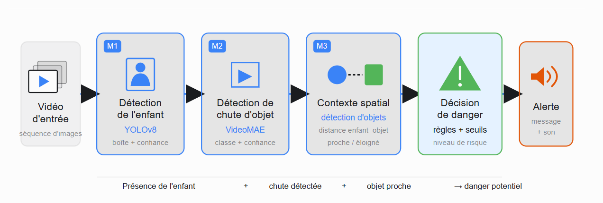

# Child Hazard Monitoring System

Research prototype of a modular video pipeline that detects a child in an indoor scene, recognizes their activity, extracts the surrounding context (nearby objects, distances, persistence over time) and decides whether the situation is hazardous.

Developed during a 4-month research internship (April to August 2026) at the **VIS2KNOW Lab, Sungkyunkwan University (SKKU)**, Seoul, as part of the engineering curriculum of **ENSICAEN**.

> Status: research prototype. Each module was trained, evaluated and tested separately; the final end-to-end run has not been archived yet (see [Limitations](#limitations)). It is not a safety device ready for deployment.



## Pipeline

```
Indoor video
   |
   |-- M1  Child detection        YOLO26m                 -> is a child present, where
   |-- M2  Activity recognition   VideoMAE                -> activity class + confidence
   |-- M3  Context extraction     YOLOE-26s + geometry    -> nearby objects, normalized distance, presence over 16 frames
   |
   v
 One JSON document per video  (explicit contract between perception and reasoning)
   |
   |-- M4  Hazard decision        Mistral-7B-Instruct, few-shot  -> hazard / no_hazard + reason
   |-- M5  Output                 JSON / CSV log
```

The decision module never sees the raw video, only the JSON produced by the perception modules. Every alert can therefore be traced back to the module that produced the information.

## Repository structure

```
.
├── 1_child_detection/       M1  YOLO and RT-DETR training and comparison
├── 2_action_recognition/    M2  VideoMAE, VideoMamba and UniFormerV2 on the RHAD dataset
│   └── augmentation/        synthetic augmentation of the objects_falling class
├── 3_context_extraction/    M3  open-vocabulary detector benchmark and context pipeline
│   └── benchmark/           protocol and annotation guidelines of the 96-image benchmark
├── 4_hazard_decision/       M4  rule baseline, 4 LLMs, QLoRA, end-to-end test
├── documentation/           architecture diagrams, literature review, model survey
├── report/                  internship report (English and French)
└── state_of_the_art/        list of the papers studied
```

Each module folder contains a `notebooks/` folder and, when relevant, a `figures/` folder with the result plots.

| Notebook | Purpose |
|---|---|
| `1_1_yolo_small_models_comparison` | Trains small YOLO models for child detection |
| `1_2_yolo_medium_training` | Trains YOLO26m and YOLO11m |
| `1_3_rtdetr_training` | Trains RT-DETRv2 |
| `1_4_yolo26m_checkpoints_comparison` | Compares two YOLO26m checkpoints |
| `2_1_videomae_training` | Fine-tunes VideoMAE V2 on RHAD and exports predictions |
| `2_2_videomamba_training` | Trains and evaluates VideoMamba |
| `2_3_uniformerv2_training` | Fine-tunes UniFormerV2 |
| `2_4_models_comparison_and_alert_threshold` | Compares the 3 video models and studies the alert threshold |
| `2_5_videomae_finetuning_training2` | Fine-tunes VideoMAE with the augmented objects_falling class |
| `2_6_videomae_old_vs_new_comparison` | Compares VideoMAE before and after augmentation |
| `3_1_object_detectors_comparison` | Benchmarks 5 open-vocabulary object detectors |
| `3_2_context_extraction_pipeline` | Builds the per-video context JSON (M1 + M2 + M3) |
| `4_1_full_pipeline_and_llm_comparison` | Runs the pipeline on 48 videos and compares the decision methods |
| `4_2_end_to_end_system_test` | End-to-end test of the frozen system on 5 videos |

Code comments inside the notebooks are written in French.

## Results

### M1 – Child detection
ChildDetection dataset: 2,257 images, single class `child` (2,192 train / 50 val / 15 test).

| Model | mAP@50 | mAP@50-95 | F1 | Size |
|---|---|---|---|---|
| YOLO11m | 0.967 | 0.894 | 0.934 | 40.5 MB |
| **YOLO26m** | **0.989** | **0.935** | **0.957** | 44.0 MB |
| RT-DETR L | 0.976 | 0.915 | 0.954 | 66.2 MB |

### M2 – Activity recognition
RHAD dataset: 3,248 videos, 12 classes. A data leak was found in the original split (clips from the same source video ended up in both train and test). All models were retrained on a split grouped by source video (2,578 / 335 / 335, seed 42).

| Model (validation) | Top-1 | Macro F1 | Abnormal recall |
|---|---|---|---|
| **VideoMAE** | **91.34 %** | **89.68 %** | **100 %** |
| UniFormerV2 | 89.25 % | 88.15 % | 100 % |
| VideoMamba Middle | 85.08 % | 77.92 % | 99.33 % |

On the test set, VideoMAE reaches 88.66 % Top-1 and a Macro F1 of 0.815; it detects all 300 abnormal videos with 2 false alarms out of 35 normal videos.

### M3 – Context extraction
Five open-vocabulary detectors compared on a manually annotated benchmark (96 images, 442 boxes, 43 object classes).

| Model | F1 | mAP@0.50 | Speed |
|---|---|---|---|
| OWLv2 | 0.361 | 0.458 | ~1.2 img/s |
| **YOLOE-26s** | 0.277 | 0.430 | **~50 img/s** |
| YOLO-World | 0.272 | 0.345 | fast |
| OmDet-Turbo | 0.263 | 0.425 | intermediate |
| Grounding DINO | 0.065 | 0.081 | slow |

YOLOE-26s was kept as the best quality/speed trade-off.

### M4 – Hazard decision
24 test videos (16 hazard / 8 no_hazard), annotated manually; methods selected on 24 separate calibration videos.

| Method | F1 | Recall | FP | Valid JSON |
|---|---|---|---|---|
| Deterministic rules | 0.774 | 0.750 | 3 | 100 % |
| **Mistral-7B few-shot** | **0.828** | 0.750 | **1** | **100 %** |
| QLoRA Mistral-7B | 0.727 | 0.750 | 5 | 100 % |
| Qwen2.5-3B few-shot | 0.476 | 0.313 | 0 | 100 % |
| TinyLlama-1.1B | 0.813 | 0.813 | 3 | 0 % (not usable) |

Mistral-7B-Instruct in few-shot mode is the final decision engine. QLoRA fine-tuning on 24 examples did not improve it (documented negative result).

Full details are in the [internship report](report/internship_report_en.pdf).

## Running the notebooks

The notebooks were written for **Kaggle** (Python, Tesla T4 GPU). They read their inputs from Kaggle datasets mounted under `/kaggle/input/datasets/<owner>/<dataset>/` and write to `/kaggle/working/`.

The datasets are **not included** in this repository. To run a notebook:

1. Get access to the data (RHAD, ChildDetection and the object benchmark belong to the VIS2KNOW Lab).
2. Upload it as Kaggle datasets, or ask for access to the existing ones.
3. Attach them to the notebook and update the paths at the top of the notebook if the owner or dataset names differ.

Kaggle inputs used by each module:

| Module | Kaggle datasets |
|---|---|
| M1 | `childdetection` (images + YOLO labels) |
| M2 | `training` (RHAD, 12 classes), `training2` (RHAD + augmented objects_falling) |
| M3 | `training`, `objectdetectionbenchmark` (96 frames + COCO annotations) |
| M4 | `part4json` (per-video context JSON) |

Some notebooks also take the outputs of earlier ones as inputs (trained checkpoints and predictions, for example `yolo26good` for YOLO26m and `videomae-final-rhad-results` for VideoMAE). Run the modules in order, 1 to 4.

External code is downloaded by the notebooks themselves: [VideoMAEv2](https://github.com/OpenGVLab/VideoMAEv2), [VideoMamba](https://github.com/OpenGVLab/VideoMamba), [RT-DETR](https://github.com/lyuwenyu/RT-DETR) and [Ultralytics](https://github.com/ultralytics/ultralytics).

## Limitations

| Limitation | Next step |
|---|---|
| Child detection drops under occlusion (head_stuck: 18.75 %) | Add occluded and blurred examples |
| Open-vocabulary detection F1 is only 0.277 | Extend the benchmark and adapt YOLOE |
| VideoMAE scores are not calibrated | Calibrate the probabilities |
| No identity tracking | Add ByteTrack or BoT-SORT |
| Distances are computed in 2D | Estimate depth |
| Final end-to-end run not archived | Run and archive notebook `4_2` |
| Small evaluation sets (24 test videos for M4) | Annotate more videos, with a second annotator |

## Acknowledgements

Supervised by Prof. Muhammad Khan and Shehzad Ali (VIS2KNOW Lab, SKKU) and Karim-Eric Ziad-Forest (ENSICAEN). The RHAD dataset and the HazardNet model come from:

S. Ali et al., *Towards Hazardous Activity Recognition for a Novel Real-World Dataset*, ACM Multimedia 2025, doi:10.1145/3746027.3754795.

## Author

Nisrine Khnifass, computer science engineering student at ENSICAEN.
